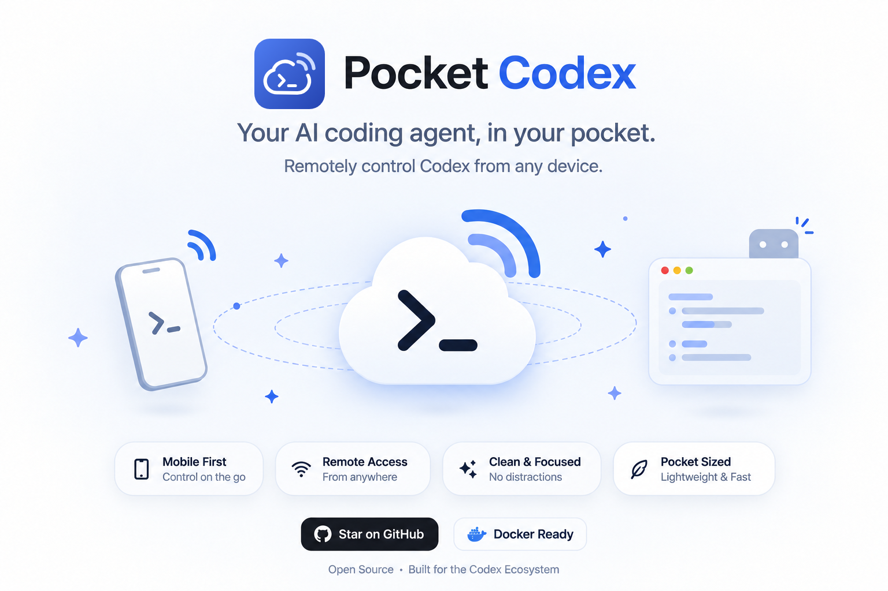

<p align="center">
  
</p>

<h1 align="center">Pocket-Codex</h1>

<p align="center">
  <em>Carry your Codex in your pocket. Drive it natively from any device.</em>
</p>

<p align="center">
  <a href="#status"></a>
  <a href="https://www.rust-lang.org"></a>
  <a href="https://flutter.dev"></a>
  <a href="LICENSE"></a>
</p>

<p align="center">
  <strong>English</strong> · <a href="README.zh-CN.md">中文</a>
</p>

> [!WARNING]
> **Pocket-Codex is under active development.** Nothing here is stable
> yet — APIs, on-disk layout, the protocol mapping and even the crate
> boundaries are expected to change without notice. Do **not** depend on
> it for production workloads. Pull requests, design feedback and bug
> reports are very welcome while we hammer out the foundations.

## What is this?

Pocket-Codex is an experiment in turning the upstream
[`codex app-server`](https://github.com/openai/codex) protocol into a
portable, multi-device experience, and additionally exposing the host's
Codex login as a relay-reachable Responses API endpoint for any device:

- A pure-Rust CLI manages a local `codex app-server` process on the
  machine where Codex is installed.
- The same CLI ships an in-process **Responses API proxy** that reuses
  the host's `codex login` (ChatGPT account or `CODEX_ACCESS_TOKEN`) to
  serve OpenAI-compatible `/v1/responses` HTTP + WebSocket traffic, so
  devices *without* Codex installed can drive the same model through
  the relay.
- The CLI uses [`pb-mapper`](https://github.com/acking-you/pb-mapper) to
  register either service under `pcx:<device>:<kind>:<name>` keys, or
  to subscribe to remote ones, materialising them as local TCP
  endpoints.
- A Flutter front-end (driven through `flutter_rust_bridge`) consumes
  the app-server JSON-RPC protocol directly, giving every platform a
  native UI for Codex without re-implementing model logic.
- **Two ways to connect.** *Self-host* — point every device at your own
  `pb-mapper` relay with a shared 32-byte key (the original flow).
  *Hosted account* — run the optional `pocket-codex-backend` once on your
  server, then every device just signs in with **GitHub**
  (`pocket-codex login`, or "Sign in with GitHub" in the app); the backend
  hands each account a short-lived relay credential scoped to its own
  `pcxu:<user>:…` namespace, and devices then talk to the relay directly. The
  relay's administrator key is never handed to clients, accounts can't see each
  other, and the backend isn't in the middle of your traffic.

In short: **one machine stays logged in to Codex; every other device —
the Flutter UI, a remote `codex` CLI, or any OpenAI-compatible tool —
reaches it through the relay**, either with a shared relay key (self-host)
or a per-account GitHub login (hosted).

## Status

| Area                           | State                                  |
| ------------------------------ | -------------------------------------- |
| Workspace / lints / CI         | bootstrapped                           |
| `pocket-codex` CLI             | `login`, `logout`, `account`, `init`, `serve`, `connect`, `api {serve,connect}`, `services {list,default set}`, top-level `status`/`stop`, `codex {start,stop,status}`, `pb {register,subscribe,status}`, `remote-hint`, `version` |
| `pb-mapper` register/subscribe | SDK 0.6.0 from the `pocket-codex` branch, pinned by `Cargo.lock`; bounded recovery and data-v2 nonce separation without data-key derivation or extra frame bytes |
| `codex app-server` supervision | native process identity, upgrade-aware executable matching, and state.toml |
| App-server protocol | synced to upstream main `b38942ce7` (2026-10-08), fork merge `b360f3350`; verified aggregated command output, persisted truncation markers, unknown error variants, initialization and opaque history cursors ([audit](docs/app-server-protocol-sync.md)) |
| macOS releases | Fixed blue Dock icon in light/dark mode, and a monochrome menu-bar icon in the menu bar's own colour. Developer ID signing, Apple notarization and stapled tickets for DMG/ZIP; required credential setup and release-only theme regression: [macOS distribution](docs/macos-release.md). |
| Android releases             | persistent release signing from v0.2.4, APK integrity/ABI/page-alignment checks, and SHA-256 checksums; older debug-signed installations need to be removed before switching signing identities (save settings first). |
| External Codex hosting        | all desktop hosts spawn an installed `codex`; the mobile/desktop bridge uses wire envelopes without linking Codex protocol crates or their runtime dependencies. macOS GUI hosts resolve a login-shell PATH on demand for Codex/Node without blocking window creation or changing the controller environment. **Built-in engine** is disabled and not implemented. Existing embedded auto-host settings restore using external Codex, which must be installed or selected by path. |
| Conversation history | child sessions start collapsed, including Active; manual folds survive live updates and inventory refresh; local-session availability and empty states; explicit loads reveal/highlight new content, scroll loads preserve position, and short pages accept edge gestures; bounded session cache, authoritative pagination end, and gaps at their actual position after timeline jumps; cached turn pages, explicit retry, stable reading position, and linear timeline grouping. The transcript is anchored at a centre row, so pages and gaps filled above never move what is on screen and a jump lands exactly in its first frame, with the turn above read ahead; a fully read turn is never fetched again. Codex Desktop automation runs show as compact capsules opening into their instructions, empty replies leave no row, and a pasted attachment whose temp file is gone is served from the rollout's inline copy |
| Review | a review sidebar beside the conversation from 1100 px (an overlay panel below that, its own page with swipe-back on phones): this conversation's edits by file, every edit in order or one step opened from its change card, or the working tree against its upstream; lazy diffs with gap expansion and a whole-file view with the changes marked, read through the session's file route; a working tree not yet read says so with a retry |
| Phone navigation | the sessions list lies under the conversation: a horizontal swipe anywhere on the chat moves it aside with the finger, rests where held, and on release completes the direction last moved (no distance threshold), with one light haptic when it settles open, and opening never raises the keyboard; back/Escape/close controls, system gesture cancellation, reduced motion, and the list's scroll and folds are preserved. Touch tablets give the inline sidebar its full default width. Covered by widget tests, and on an iPhone 15 / iOS 17.5 simulator: edge drag, release, reverse-drag cancel (earlier edge/threshold build), close, list touch scroll kept across close/reopen, a multiline draft kept, Chinese pinyin composition and Return inserting a newline without sending. The simulator has no haptic feel; haptics and system pointer cancellation are covered by widget tests only, and no physical phone or tablet has been checked. |
| Provider-native local history | Desktop Local sessions selects Codex, Claude or OpenCode. Claude and OpenCode history opens without an ACP connection, with bounded older pages and foreground read-only following; browsing never resumes an external writer. Claude ownership is checked against native session metadata and process identity; unavailable evidence remains unknown. Browsing stays read-only; a session continues by opening it on a running Claude or OpenCode host, which resolves its access automatically (write when admitted, otherwise followed with the reason; no takeover step). Pocket hosts exclude each other; native clients do not honor that and must remain closed for the session. New ACP conversations prepare automatically for the selected folder; a first-run folder picker works without saved projects ([scope and limits](docs/native-agent-history.md)). |
| Mobile message actions | visible press feedback through menu dismissal; long-press menus for copy, text selection and native sharing in conversations and read-only views; edit user text into the current draft without losing existing text/attachments, sending automatically, or changing history |
| Native image generation | live generation/loading feedback, inline previews and native file saving, retryable remote artifact reads, and restored/monitored/read-only results; uses the external Codex image tool ([verification](docs/native-image-generation.md)) |
| Session file links | live and read-only session links with rendered Markdown, JSON, CSV/TSV and SVG previews plus a source view, image previews, streamed remote downloads with legacy Host Files support, mobile Save As, verified local reads, and pb-mapper guidance for remote localhost pages ([details](docs/session-file-links.md)) |
| Persistent controller cache | configurable 512 MB App-wide disk cache, automatic restoration of retained pages within the memory budget, bounded live checkpoints, verified window/text deltas across reconnects, foreground running-session prefetch, and bounded eviction; provider-neutral `SessionHistorySource` adapter ([protocol and limits](docs/session-cache-sync.md)) |
| Turn controls | Auto approval review by default, separate manual/read-only/full-access modes, capability-gated Fast, and running-turn supplements alongside the default next-turn queue (ACP supplements only where the agent negotiated steering); the queue waits for an admitted turn and keeps a refused message first in line until Retry; composer controls recover in the same session when a turn ends; Plan is available under Advanced settings |
| History loading and monitoring | delayed static initial feedback, delta-only continuation, and tail-only monitoring updates; show history before optional settings/model discovery; connect in-app hosts over loopback; coalesced gap actions survive monitoring refreshes; background ownership discovery automatically moves unopened sessions into and out of Active |
| Long timeline navigation | draggable compact controls that load unloaded turns, folded on narrow and touch layouts into a faint handle that opens on touch and folds again after 5 s or a scroll; spaced overview ticks, a searchable virtualized turn directory, and bounded 25-step browsing for long work groups that follows a running turn's newest step on desktop and mobile |
| Model review history | live and restored approval progress/results in the parent conversation, read-only Guardian sessions, and expandable parent/child session lists; original payloads stay available on demand ([details](docs/guardian-sessions.md)) |
| Transport compression | host HTTP negotiates Zstd/Gzip; app-server WebSocket offers permessage-deflate when the external server supports it; uncompressed peers and streaming SSE remain compatible |
| ACP agents                     | host ACP v1 stdio agents from a program and argument list, with the Claude (`claude-agent-acp` adapter) preset, picked from an icon grid beside Codex and native OpenCode. Desktops host several instances side by side (Codex app-servers, one native OpenCode host, Claude, custom agents) in self-host and account mode, with up to 16 restore records per kind kept by name; the host switcher shows each agent's mark and reaches host management. ACP model, effort and mode are searchable, grouped controls driven by the agent's complete option set, and can be chosen before the first prompt. Codex and OpenCode stay on their native protocols; all other agents use ACP. Negotiated capabilities drive shared session controls, exact permission choices and attachments. The host owns the agent process group and exposes bounded history with visible gaps, reconnect recovery and guards against stale requests. Responsive hosting and session UI covers mobile, tablet and desktop. ACP hosting is Unix-only (tested on macOS); Windows ACP hosting is disabled, while native Codex hosting stays available on every desktop. The Claude preset finds the `@agentclientprotocol/claude-agent-acp` adapter, a Node.js 22+ for it and the native `claude` CLI on this computer, and its Prepare ACP environment action (or Start) can prepare the pinned adapter 0.89.1 into the app cache (with measured download bytes/speed, cancel and retry); Claude host configuration exposes per-host environment overrides for credentials, exact models/aliases, reasoning and network; defaults inherit available environment (including the macOS login shell), without adding a login flow. ACP turns queue for the next turn, and agents that advertise steering (Claude's adapter does) also accept supplements to the running turn. A queued message whose send may have reached the host stays queued, marked, and is sent again only by the user's explicit Retry; a send or supplement answered after its host connection changed adopts nothing and never changes a draft or a newer request it no longer owns. The full Rust and Flutter suites pass. On one Mac a live run prepared the pinned adapter 0.89.1 into the app cache beside a compatible Node.js, and the real Claude adapter answered prompts, took an injected supplement and, when idle, fell back to one queued turn (`promptRequired`). The ACP engine was earlier exercised with the since-removed OpenCode ACP preset (1.18.35) through a public relay with separate host/controller processes; an opt-in same-process test covers two native Codex and two ACP hosts started, stopped and restarted side by side, all on one Mac ([details](docs/acp-agents.md)) |
| Native OpenCode | a third engine hosting the installed `opencode serve` over its v1 HTTP/SSE API (`opencode:<name>` keys), several hosts with one per history source (OpenCode's shared default database, or a host's own), OpenCode's own configuration and sign-ins or a per-host custom provider (Responses, Anthropic Messages, Chat Completions) as its model service, offering every model the gateway lists at start/Apply beside the default model (only the default, with a warning, when the list cannot be read); new conversations ask for a project folder before sending; per-project native model/agent/variant options (read asynchronously; draft choices applied on first send) and `/` commands in place of the Codex model menu, multiple-choice questions, automatic session access shared with Claude hosts, with at most 256 retained sessions (idle ones forgotten and reopened explicitly; a session without a retained admission opens again only through Check now or Continue here) and a deleted session removed from its controller alone, including one deleted by another OpenCode process and found by an access or follow check; a new conversation offers Hand back after its turn without reopening, and a handed-back session is never reacquired automatically (only Continue here reacquires it). Model failures show one inline card with a fixed reason (the provider's message is never shown), Change model and an explicit Retry of the exact original message, withheld for a truncated or attachment-missing copy; a completed reply that is only reasoning, with no separate text, is shown in full with a note, nothing extracted or relabelled. Apply restarts the host and open views reconnect on their own; quit stops the owned `opencode serve` (on macOS also Cmd+Q, Dock and menu quit). Replaces the removed `opencode acp` preset and its catalog plugin. The full Rust (831 passed, 24 ignored) and Flutter (1557 passed, 5 skipped) suites pass. On one Mac with OpenCode 1.19.0, real-server integration and bridge lifecycle tests passed. In the final macOS build a new conversation's first reply arrived, Hand back was offered without reopening, and Release and Continue here kept the same session ID and an unsent draft with no duplicate history or automatic send. In an earlier build of this round a region-refused model showed its card, Change model to another model sent nothing and kept a newer draft, Retry sent the original prompt and was answered, and a reasoning-only reply showed in full when its existing history was inspected without sending (the read-only viewer by tests only). In an earlier build a session held by another OpenCode process stayed read-only and, once freed, opened its original ID only on Check now and answered; Release showed the sent message once with only Continue here, which kept an unsent draft and sent nothing; a session deleted by the official CLI in another process became terminal (no Continue, Check or composer) and left the list, while another session still answered. In an earlier build of this round two real projects showed their own model names for the same model ID, their own agents and commands, kept each draft's choices and sent nothing on switching, and a first send in one project and an agent change in an existing session each received a real reply (other variants by tests only). Earlier builds sent through the native catalog and custom Chat Completions and Anthropic Messages providers, listed all 110 models of a custom gateway with a non-default one answering, reconnected after Apply with the catalog replaced in place and the draft kept unsent, and restored hosting and the same original session after Cmd+Q and relaunch. Not verified: a successful Responses reply (the request reached the provider, which refused the model; further testing waived), relay or multi-controller use and other platforms. ([details](docs/opencode-native.md)) |
| Hosting configuration | one responsive editor creates and edits hosts; Start, Save, Restart and Stop show their progress on their own button, pin their outcome above the actions and confirm a finished start or stop with a toast; each host saves its model service: existing configuration, official Codex sign-in in place (no running host needed), or a custom provider (Codex: Responses; Claude preset: Anthropic Messages; native OpenCode: Responses, Anthropic Messages or Chat Completions; other ACP agents keep their own configuration). Keys stay on this device and reach the agent only through its environment; a keyed Codex host's raw output is never kept (its log and viewer show fixed notices only). Codex hosts and the sign-in server verify their effective route before use. A launch owns its endpoint only when the listening sockets its listen address reaches are held by the process it spawned (or that process's child), observed at fixed points; only owned processes are stopped, and one that does not exit stays listed, keeps its name and is stopped again by Stop or quit; a quit that cannot stop everything it owns keeps the app open. A running host's runtime (Codex binary/port/proxy, ACP program/args) and provider are saved without a restart and applied by an explicit, confirmed restart of the reviewed incarnation and revision, which restores the previous runtime on failure. The `api:<name>` service stays a separate official Responses proxy. Settings, Codex setup and the chat's setup banner open the same editor (a running host picked by its identity, the chat's own host, or a new one); Codex setup keeps only Codex's own sign-in and prompt option. At the editor's release (historical counts), the full Rust suite (743 passed, 14 ignored), Flutter suite (l10n, format, analyze; 1326 passed, 5 existing skips) and macOS profile build passed. Native UI checks covered Settings and Codex setup routing to running hosts or a new host, repeated selection, keyboard cancellation, return navigation and unsaved-change protection. Live on one Mac: native Codex custom Responses with two real models across save and apply, the since-removed OpenCode ACP preset's Responses and Anthropic Messages routes with real models, the official Responses proxy over HTTP/SSE and WebSocket through a public relay, and save/apply ownership for native and Claude hosts. That former ACP preset's Chat Completions route was checked only against a deterministic local fixture; native OpenCode's own evidence is in its row. Not exercised: completing an interactive OAuth sign-in, other platforms, hosted-account mode, effort options ([details](docs/hosting-configuration.md)) |
| Direct Responses API proxy     | local HTTP/WS proxy registered through pb-mapper |
| Hosted account (GitHub)        | optional `pocket-codex-backend`: GitHub login, then a short-lived per-account relay credential (`/v1/relay`) scoped to a `pcxu:<user>:…` namespace — clients register/connect against the relay **directly** and the administrator key never leaves the server; self-host preserved behind `--relay`. See [`deploy/`](deploy/README.md) |
| Flutter UI (`apps/flutter`)    | chat-first home (opens straight into the latest session, cross-fading from the connecting splash; all sessions in the sidebar, behind a skeleton until the host first lists them, with neutral selection, animated running indicators, accessible hierarchy controls and stacked metadata at narrow widths or large text sizes; auto-connects to the explicit default / last-used / locally hosted / first reachable host, desktop auto-restores hosting); account onboarding ("Sign in with GitHub") + self-host onboarding (relay+key, `pcx1:` import/export); device-first service management, settings, sessions, and logs with shared secondary-page navigation; shared calm neutral design system with one blue signal colour (no purple), layered translucent (liquid-glass) surfaces, anchored desktop popovers, persistent utility navigation, adaptive desktop/tablet/phone layouts (light/dark), Markdown user and agent messages, a theme switch that spreads from the control pressed, a compact composer with automatic height, visible height reset, expanded editing with a live Markdown preview, conversation and per-project unsent drafts retained during the app session, minimal new-session views, project shortcuts revealed on hover/keyboard focus or touch long-press, separate Queue/Stop actions, mobile newline / desktop Enter-to-send, retryable attachments, and matching icons/artwork |
| Live voice | WebRTC voice conversations on mobile and desktop through external Codex; distinct persisted voice-session markers, model/voice selection, a persistent call status with mute, hang-up and barge-in, paginated speech transcripts, and composer dictation on the same realtime path. Requires a host/account with realtime access. No system speech provider. See [voice controls](docs/live-voice.md). |
| Remote device management | Stable installation identities and distinct default relay keys for Windows, WSL distributions and separate installations on one computer; host-reported OS, architecture and distribution metadata; independent local controls even before hosting starts, with no hostname-based locality guesses. CLI `serve --allow-remote-management` shares the desktop native engine without Flutter, publishes a management-only `host:pocket` entry, restores authoritative service choices and handles SIGINT/SIGTERM; a desktop can allow other devices (a phone included) to add, edit, apply and stop its Codex, native OpenCode, Claude and saved services through a management-only `host` entry, with revision/incarnation checks, write-only secrets, no automatic resend and authoritative restore; a per-host default project folder for new conversations; a concise status page with expandable diagnostics; Refresh services in the chat host switcher and compact Add service rows with path details. Covered by widget tests; phone add/edit/apply verified against a real desktop host, and the current functionality accepted by the user on the installed desktop and iOS apps; no physical-phone haptics or other platforms claimed ([details](docs/remote-device-management.md)) |
| Relay recovery | Scoped host restarts, retained offline meta registration, account-owned renewal and cancellable mobile reconnect; bounded transition diagnostics; exact `pb restart --role … --key …` maintenance. With the relay unreachable a desktop still restores and opens its own hosts directly and the services page keeps them, naming the cause when the relay's name resolves to a proxy's or VPN's unrouted virtual address |

Multi-device CLI flows are usable in both modes:

- `pocket-codex login` / `logout` / `account` drive the **hosted-account**
  mode: a GitHub device-flow session (token stored 0600 in `config.toml`) makes
  `serve` / `connect` / `api` / `services` work with **no relay or key** — the
  backend vends a per-account credential and the CLI publishes under
  `pcxu:<user>:…` keys on the relay itself. The `--relay`
  examples below are the **self-host** mode, which an explicit `--relay` flag
  always selects (the escape hatch).
- `pocket-codex init [--relay <host:port>] [--key <32B>]` persists the
  default relay address and shared `MSG_HEADER_KEY` to
  `~/.config/pocket-codex/config.toml` (0600 on Unix). All subsequent
  commands default to this config (precedence: `--relay` flag > config >
  `$PB_MAPPER_SERVER`); `--relay` still overrides per-invocation.
- `pocket-codex serve --relay <host:port>` starts or reuses the local
  `codex app-server`, registers it as `pcx:<device>:app:<name>` and
  prints the matching client-side command.
- `pocket-codex connect --relay <host:port>` subscribes to the remote
  app-server selected by `--device` / local default / relay discovery,
  exposes it locally and prints the exact `codex --remote ...`
  invocation to start Codex against that listener.
- `pocket-codex api serve --relay <host:port>` exposes the host Codex
  login as a loopback Responses API proxy and registers
  `pcx:<device>:api:<name>`.
- `pocket-codex api connect --relay <host:port>` subscribes to that API
  proxy and prints a local `model_providers` config snippet for Codex.
- `pocket-codex services list --relay <host:port>` discovers available
  `pcx:*` services; `pocket-codex services default set ...` records the
  local default device when a command does not specify one.

See [`AGENTS.md`](AGENTS.md) for the detailed roadmap and contributor
conventions.

## Repository layout

```
pocket-codex/
├── apps/
│   └── flutter/                 # Flutter UI (FRB-driven, FVM-locked)
├── assets/
│   └── logo/                    # Project artwork (poster, logo)
├── crates/
│   ├── pocket-codex-core        # shared types, config, state, paths
│   ├── pocket-codex-codex       # codex app-server process manager
│   ├── pocket-codex-pb          # pb-mapper register/subscribe glue
│   ├── pocket-codex-cli         # `pocket-codex` binary
│   └── pocket-codex-bridge      # cdylib consumed by flutter_rust_bridge
├── deps/
│   └── codex/                   # upstream codex (git submodule)
├── docs/                        # design notes & protocol references
└── skills/                      # contributor / agent skill packs
```

## Getting started

> Heads up: this is bootstrap-quality. CLI flags, on-disk state,
> protocol coverage and UI surface area are all expected to change.

### Install the CLI (one-liner)

Grab the `pocket-codex` binary from the latest release — no toolchain needed.
The installer picks the build for your OS + CPU (static-musl on Linux, native
on macOS/Windows) and drops it on your `PATH`.

```bash
# Linux / macOS
curl -fsSL https://raw.githubusercontent.com/acking-you/pocket-codex/main/scripts/install.sh | sh
```

```powershell
# Windows (PowerShell)
irm https://raw.githubusercontent.com/acking-you/pocket-codex/main/scripts/install.ps1 | iex
```

Overrides (env vars): `POCKET_CODEX_VERSION` pins a tag (e.g. `v0.1.3`),
`POCKET_CODEX_BIN_DIR` sets the install dir, `POCKET_CODEX_NO_MODIFY_PATH=1`
skips the PATH step. Prefer a package or a from-source build? See below.

### Rust workspace

```bash
# Clone with submodules (deps/codex).
git clone --recurse-submodules git@github.com:acking-you/pocket-codex.git
cd pocket-codex

# If you cloned without --recurse-submodules:
git submodule update --init --recursive

# Build everything in the workspace.
cargo build --workspace

# Inspect the CLI surface.
cargo run -p pocket-codex-cli -- --help
```

A working `codex` binary is expected to exist on `$PATH`; Pocket-Codex
does **not** vendor a model runtime. The CLI exposes:

```text
pocket-codex login                          # hosted account (GitHub)
pocket-codex logout
pocket-codex account
pocket-codex init                           # self-host (relay + key)
pocket-codex serve
pocket-codex connect
pocket-codex api      serve | connect
pocket-codex services list | default set
pocket-codex status
pocket-codex stop
pocket-codex codex   start | stop | status
pocket-codex pb      register | subscribe | status
pocket-codex remote-hint
pocket-codex version
```

#### Hosted account (recommended)

Sign in once with GitHub and every command works **without a relay address or
shared key**. Requires a reachable `pocket-codex-backend` — run your own; see
[`deploy/`](deploy/README.md).

> **Full step-by-step guide (CLI + app):** [`docs/usage.md`](docs/usage.md)
> （中文：[`docs/usage.zh-CN.md`](docs/usage.zh-CN.md)）。

```bash
pocket-codex login                 # GitHub device flow: open the URL, enter the code
pocket-codex account               # who you're signed in as + transport mode

# Host: expose this machine's codex app-server under your account.
pocket-codex serve

# Another device: sign in to the SAME GitHub account, then list + drive services.
pocket-codex services list
pocket-codex connect               # picks your default / only app-server
codex --remote ws://127.0.0.1:28080

# Or reach your Codex login as an OpenAI-compatible Responses API.
pocket-codex api serve
pocket-codex api connect

pocket-codex logout                # revoke + clear the local session
```

In the **app** this is just "Sign in with GitHub" on first launch; the same
account's app-servers then appear on the home screen, ready to drive.

#### Self-host (advanced)

Pass `--relay` (and set a shared 32-byte key via `init`) to bypass the account
backend and talk to your own `pb-mapper` relay directly. An explicit `--relay`
**always forces self-host mode**, even when you are logged in — it's the escape
hatch.

```bash
pocket-codex init    --relay relay.example.com:7666   # persist relay + 32B key
pocket-codex serve   --relay relay.example.com:7666   # host side
pocket-codex connect --relay relay.example.com:7666   # client side
codex --remote ws://127.0.0.1:28080
pocket-codex api serve   --relay relay.example.com:7666
pocket-codex api connect --device my-host --relay relay.example.com:7666
```

### Flutter front-end

`apps/flutter` is a Flutter app that talks to Rust through
`flutter_rust_bridge`. Flutter is locked at the project level via
[FVM](https://fvm.app/) (`.fvmrc`) and at the language level via
`pubspec.yaml`'s `environment.flutter` field; CI uses
`subosito/flutter-action@v2` against the same pin.

```bash
# One-time: install fvm and the pinned Flutter version.
brew tap leoafarias/fvm && brew install fvm
fvm install 3.44.0 --setup

# Day-to-day:
cd apps/flutter
fvm flutter pub get
fvm flutter analyze
fvm flutter test
```

If you change anything under `crates/pocket-codex-bridge/src/api/`,
re-run the codegen:

```bash
flutter_rust_bridge_codegen generate
```

## License

Pocket-Codex is licensed under the [Apache License 2.0](LICENSE).

The upstream projects under `deps/` keep their own licenses; consult
each submodule for details.
